<div align="center">
  
  <h1>NovaVault</h1>
  <p><strong>Zero-Knowledge Cross-Platform Password Manager &amp; 2FA Authenticator</strong></p>
  <p>Built by <a href="https://novagenvpn.com">NovaGenSoftware Solutions</a> · Engineered by Heshan Sathyanga</p>

  <p>
    
    
    
    
    
  </p>
</div>

---

## Overview

**NovaVault** is an enterprise-grade, zero-knowledge password manager and built-in TOTP 2FA authenticator designed for seamless security across **Windows Desktop** and **Android**. Your vault is encrypted locally using **AES-256-GCM** before anything ever touches the cloud, and syncs privately through your own Google Drive `appDataFolder`.

---

## Key Features

- **Zero-Knowledge Encryption (`AES-256-GCM`)**: Credentials, cards, secure notes, identities, and server secrets are encrypted locally on your device.
- **Private Google Drive AppData Sync**: Multi-account isolated Google OAuth 2.0 sync stored inside your hidden Google Drive `appDataFolder` — only NovaVault can access its encrypted backup file.
- **Built-in 2FA Authenticator (TOTP)**: Live 6-digit rotating codes with countdown rings and one-tap copy, stored alongside your logins.
- **Flexible App Lock & Biometrics**:
  - First-launch security onboarding (`Master Password`, `Device Lock Only`, or `No Lock`).
  - Native Android `BiometricPrompt` & `KeyguardManager` support (Fingerprint, Face, Pattern, PIN).
  - Toggleable in Settings at any time.
- **Vault Health & Security Audit**: Real-time password strength scoring, weak-password detection, and one-tap strong password/passphrase generator.
- **Native Desktop & Mobile UX**: High-density 3-pane desktop workspace on Windows and responsive touch-first mobile interface on Android.

---

## Download (Ready-to-Install)

Pre-built installers and APKs are published on the [**Releases**](https://github.com/Heshan-HS/nova_vault/releases) page:

| Platform | Package | Direct Download |
| :--- | :--- | :--- |
| **Windows (x64)** | `NovaVault-v1.0.3-Setup.exe` | [Download Windows Installer](https://github.com/Heshan-HS/nova_vault/releases/download/v1.0.3/NovaVault-v1.0.3-Setup.exe) |
| **Android** | `NovaVault-v1.0.3-Android.apk` | [Download Android APK](https://github.com/Heshan-HS/nova_vault/releases/download/v1.0.3/NovaVault-v1.0.3-Android.apk) |

> **Tip:** Both platforms sync automatically with the same Google account — sign in with Google on Windows and Android to keep your vault in sync.

---

## Project Structure

```text
├── novavault_flutter/       # Main Flutter application (Windows & Android)
│   ├── lib/
│   │   ├── models/          # VaultItem & data models
│   │   ├── screens/         # Desktop, Mobile, Setup, Unlock, Security & Settings UI
│   │   ├── services/        # VaultService, AuthSyncService, SecurityAuthService
│   │   └── theme/           # Light & Dark design tokens
│   ├── android/             # Native Kotlin MainActivity (OAuth deep-link + BiometricPrompt)
│   ├── windows/             # Windows runner & app icon resources
│   └── installer/           # Inno Setup script (novavault.iss)
├── novavault-web/           # Web companion UI (React + TypeScript + Vite)
└── LICENSE
```

---

## Build From Source

### Prerequisites
- [Flutter SDK](https://docs.flutter.dev/get-started/install) (3.x+)
- Visual Studio with **Desktop development with C++** (for Windows builds)
- Android SDK / JDK 17 (for Android APK builds)
- [Inno Setup 6](https://jrsoftware.org/isinfo.php) (optional, for building the Windows `.exe` installer)

### 1. Clone & Fetch Dependencies
```bash
git clone https://github.com/Heshan-HS/nova_vault.git
cd nova_vault/novavault_flutter
flutter pub get
```

### 2. Configure Google OAuth (Optional for Cloud Sync)
Pass your Google OAuth Desktop Client Secret at build time using `--dart-define`:
```bash
flutter run -d windows --dart-define=GOOGLE_CLIENT_SECRET=your_client_secret
```

### 3. Build Release Binaries
**Windows:**
```bash
flutter build windows --release
```
**Android APK:**
```bash
flutter build apk --release
```

---

## About & Contact

Developed by **NovaGenSoftware Solutions** — **Heshan Sathyanga**.

- Website: [novagenvpn.com](https://novagenvpn.com)
- Email: [novagensoftware@gmail.com](mailto:novagensoftware@gmail.com)
- License: [MIT](LICENSE)
